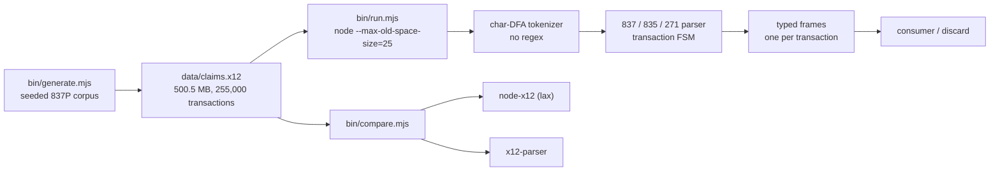

# Stanza Streaming Parser Benchmark

Reproducible benchmark for the zero-regex X12 streaming parser behind
[Stanza API](https://stanzaapi.com). It measures throughput and V8 memory on
large synthetic healthcare claim batches.

One file, 500.5 MB, 255,000 transactions: **14.2 s inside a hard 25 MB V8
old-space cap**. Under the same cap, `node-x12` takes 20.3 s (49% longer than
its uncapped run) and `x12-parser` takes 39.2 s. Uncapped, `node-x12` ties this
parser at 13.6 s against 13.4 s.

[WRITEUP.md](WRITEUP.md) covers the method and caveats.
[COMPARISON.md](COMPARISON.md) has the full head-to-head.



All data is generated locally and is synthetic. No PHI or customer data is used.

## What is measured

- **Wall time** to stream one X12 file through `iterateX12StreamFrames`, the
  NDJSON streaming path used in production.
- **Peak sampled V8 heap** (`process.memoryUsage().heapUsed`, every 25 ms) and
  whether the run completes under `--max-old-space-size=25`.
- **Record throughput**: one record is one X12 transaction (`ST`..`SE`), parsed
  into a frame and discarded. This measures parsing, not retention.

## Reproduce

With Nix there is nothing to install. The flake builds `node_modules` and
`dist/` from the lockfile.

```bash
# From anywhere, no checkout: generate ~5 MB and run under the cap.
nix run github:StanzaAPI/benchmark-harness#smoke

# Full run from a checkout.
nix run .#generate -- --transactions 255000 --claims 5 --out data/claims.x12
nix run .#bench    -- data/claims.x12
nix run .#compare  -- --file data/claims.x12 --cap 25

# Or all of the above.
make bench
```

Without Nix, requires Node >= 23:

```bash
npm install
npm run build
node bin/generate.mjs --transactions 255000 --claims 5 --out data/claims.x12
node --max-old-space-size=25 bin/run.mjs data/claims.x12
```

## Reference results

Hardware: Intel Core i7-10700K @ 3.80 GHz, 31 GiB RAM, Linux 7.2.5, Node
v26.8.2. Synthetic file: 500.5 MB, 255,000 transactions, 1,963 bytes/record.

| Run | Wall time | Records/s | MiB/s | Peak `heapUsed` | Under 25 MB cap |
| :-- | :-- | :-- | :-- | :-- | :-- |
| 1 | 14.30 s | 17,837 | 33.4 | 31.6 MB | yes |
| 2 | 14.38 s | 17,729 | 32.8 | 20.7 MB | yes |
| smoke (5 MB) | 0.12 s | 16,468 | 26.2 | 7.9 MB | yes |

The hard constraint is the old-space cap: a run that exceeds it aborts. Both
full runs completed. Sampled `heapUsed` includes the young generation and
depends on GC timing, which is why run 1 shows 31.6 MB while still finishing
under the cap. RSS is around 140 MB, dominated by stream buffers and Node
baseline.

Throughput varies with CPU and Node version. Run the commands above to measure
your own machine.

## Design notes

- The parser is copied verbatim from production: `tokenizer.ts`,
  `parser837/835/271.ts`, `stream.ts`, and their types. The HTTP/routes layer is
  omitted.
- `DEFAULT_MAX_STREAM_RECORDS` is 50,000. Larger batches must pass
  `maxRecords`; this harness does.
- The tokenizer contains no regular expressions; segment and element splitting
  use character indexing only.

## License

Source-available under the [Business Source License 1.1](LICENSE): read, run,
modify, and benchmark this parser for non-production use. Offering it, or a
derivative, as a hosted or embedded service that competes with
[Stanza API](https://stanzaapi.com) requires a commercial license
(licensing@stanzaapi.com). Each version converts to Apache 2.0 four years after
publication.
